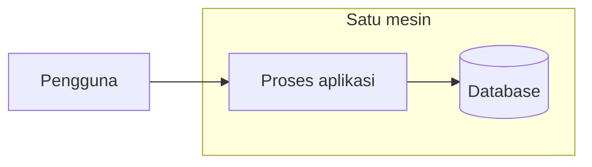

Satu aplikasi dengan satu database di satu mesin cukup untuk toko kecil, asal kamu menghitung bebannya dan menaruh data penting di database. Begini rilis pertama sebuah toko online: satu proses aplikasi dan satu database, di satu mesin.[^aws-startups-scaling-part1-primer]

## Tahap 1: cukup atau tidak untuk pengguna kita?

Misalkan toko itu punya 50.000 pengguna aktif per hari. Tiap pengguna mengirim sekitar 40 request. Jadi ada 2.000.000 request per hari. Satu hari punya 86.400 detik, sehingga rata-ratanya sekitar 23 request per detik. Satuan ini disingkat *RPS*.

Trafik tidak merata sepanjang hari. Sore hari bisa jauh lebih ramai daripada rata-rata. Selisihnya disebut *peak-to-mean ratio*, yaitu RPS puncak dibagi RPS rata-rata.[^robustperception-peak-to-mean-ratio] Pengguna toko ini ada di satu zona waktu, jadi mereka cenderung aktif di jam yang sama dan lonjakannya tajam. Pakai angka 3 sebagai asumsi awal. Puncaknya jadi 23 kali 3, sekitar 70 RPS.

Sekarang, berapa RPS yang sanggup dilayani databasemu? Itu *kapasitas terukur*. Uji pada salinan sistem dengan data seukuran produksi, jangan pada toko yang sedang berjalan. Jalankan request khas toko berulang-ulang, lalu naikkan lajunya sampai waktu responsnya melonjak tajam. Misalkan hasilnya 300 RPS (angka hipotetis).

Puncak 70 RPS baru memakai sekitar seperempat kapasitas itu, jadi kapasitasnya lebih dari empat kali puncak. Satu mesin masih cukup. Jangan merencanakan berjalan di 100% kapasitas terukur, karena lonjakan di luar perkiraan langsung membuat toko melambat.

Satu mesin tidak lagi cukup dalam dua keadaan. Pertama, kalau puncak mendekati kapasitas terukur. Kedua, kalau kamu tidak bisa menerima toko mati total saat mesinnya rusak, karena dengan satu mesin satu kegagalan mematikan semuanya.[^aws-startups-scaling-part1-primer]

## Tahap 2: setelah deploy sore, keranjang kosong

Kapasitas bukan satu-satunya hal yang bisa salah. Suatu sore kamu men-deploy versi baru, dan aplikasi di-restart. Pengguna melapor bahwa keranjang mereka kosong dan mereka harus login ulang. Riwayat pesanan mereka masih lengkap. Kenapa?

Aplikasi menyimpan keranjang dan sesi login di variabel dalam memori proses. Memori itu hilang saat proses berhenti.[^twelve-factor-app] Pesanan ditulis ke tabel database, yang berjalan terpisah dari proses aplikasi. Karena itu pesanan selamat.

*State* adalah data yang diingat aplikasi dari satu request ke request berikutnya, seperti isi keranjang. Aplikasi *stateless* tidak menyimpan state itu di dalam prosesnya. Aturannya: simpan semua yang harus bertahan di *backing service*, yaitu layanan di luar proses yang dipakai aplikasi, biasanya database.[^twelve-factor-app] Kalau keranjang dan sesi masuk tabel, deploy berikutnya tidak mengosongkannya.

Harganya: tiap request yang butuh keranjang kini membaca database. Itu sedikit lebih lambat daripada membaca memori.

Memori tetap boleh dipakai untuk nilai sementara yang hanya dibutuhkan dalam satu request. Contohnya gambar yang sedang diubah ukurannya saat upload, sedangkan hasil akhirnya disimpan ke database. Kalau prosesnya mati di tengah, pengguna cukup mengulang upload.

## Lebih dalam

Rasio puncak tipikal untuk pengguna yang tersebar di seluruh dunia sekitar 1,6 sampai 1,7.[^robustperception-peak-to-mean-ratio] Pengguna di satu zona waktu naik-turunnya lebih tajam, jadi angka 3 di atas adalah asumsi hati-hati. Ganti dengan angka dari grafik trafikmu sendiri.

Sebagai acuan di ujung atas: Stack Overflow menerima 209.420.973 request HTTP dalam satu hari di 2016.[^craver-stack-overflow-architecture-2016] Dibagi 86.400 detik, itu rata-rata sekitar 2.400 per detik. Satu primary (database utama yang menerima tulisan) di tiap cluster mereka menanggung hampir seluruh beban, di perangkat keras besar dengan RAM 384 GB pada cluster pertama.[^craver-stack-overflow-architecture-2016] Di depannya ada cache Redis dan 9 web server produksi.[^craver-stack-overflow-architecture-2016] Jadi angka itu acuan beban request, bukan bukti bahwa satu mesin biasa cukup.

SQLite adalah database berupa satu file di dalam aplikasi. Patokannya: situs dengan kurang dari 100.000 *hit* per hari seharusnya berjalan baik, sebagai estimasi konservatif.[^sqlite-appropriate-uses] Patokan itu khusus SQLite, dan "hit" belum tentu sama dengan satu request. SQLite hanya mengizinkan satu penulis pada satu waktu.[^sqlite-appropriate-uses] Kalau beban tulisnya berat atau server aplikasinya banyak, pindah ke database client/server, yaitu proses database terpisah yang diakses lewat jaringan.[^sqlite-appropriate-uses]

File di disk lokal bisa bertahan di VPS (server virtual sewaan). Tetapi state lokal biasanya ikut terhapus saat lingkungan seperti PaaS atau container memindahkan proses ke mesin lain.[^twelve-factor-app] Untuk sesi, datastore yang mendukung kedaluwarsa seperti Redis cocok dipakai.[^twelve-factor-app]
