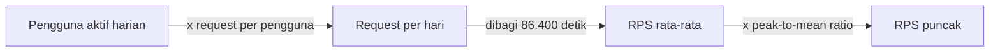

Satu proses aplikasi dengan satu database adalah rancangan awal yang sengaja minimal,[^aws-startups-scaling-part1-primer] dan hitungan sederhana bisa menunjukkan kapan rancangan itu masih cukup.

## Dari pengguna ke request per detik

*Peak-to-mean ratio* adalah RPS (request per detik) puncak dibagi RPS rata-rata dalam sehari atau seminggu. Untuk pengguna yang tersebar di seluruh dunia, nilai tipikalnya sekitar 1,6 sampai 1,7.[^robustperception-peak-to-mean-ratio] Pengguna di satu zona waktu naik-turunnya lebih tajam, jadi pakai angka lebih besar, misalnya 3, sampai kamu punya grafik trafik sendiri.

Misalkan sebuah toko punya 50.000 pengguna aktif per hari, masing-masing mengirim 40 request. Itu 2.000.000 request per hari, atau sekitar 23 RPS rata-rata. Dengan rasio 3, puncaknya sekitar 70 RPS. Misalkan juga kamu sudah mengukur bahwa databasemu sanggup 300 RPS untuk query toko itu (angka hipotetis). Puncak 70 RPS memakai sekitar seperempat kapasitas tersebut, jadi satu aplikasi dan satu database masih cukup, dengan sisa kapasitas lebih dari empat kali. Jangan rencanakan berjalan di 100% kapasitas terukur.

Sebagai acuan di ujung atas: dalam satu hari di 2016, Stack Overflow menerima 209.420.973 request HTTP ke load balancer.[^craver-stack-overflow-architecture-2016] Dibagi 86.400 detik, itu rata-rata sekitar 2.400 per detik. *Primary* (database utama yang menerima tulisan) di tiap cluster mereka menanggung hampir seluruh beban.[^craver-stack-overflow-architecture-2016] Tapi primary itu berjalan di perangkat keras besar (384 GB RAM pada cluster pertama), dengan cache Redis dan 9 web server produksi di depannya.[^craver-stack-overflow-architecture-2016] Jadi angka itu acuan beban request, bukan bukti bahwa satu mesin biasa cukup.

Untuk SQLite (database berupa satu file di dalam aplikasi), situs dengan kurang dari 100.000 *hit* per hari seharusnya berjalan baik, dan angka itu estimasi konservatif.[^sqlite-appropriate-uses] Toko tadi sekitar 20 kali angka itu, tetapi patokan itu khusus SQLite dan "hit" belum tentu sama dengan satu request, jadi jangan dipakai untuk PostgreSQL.

## Kapan satu mesin tidak cukup

Hitungan RPS hanya memeriksa volume. Satu mesin tanpa server cadangan berarti satu kegagalan mematikan semuanya.[^aws-startups-scaling-part1-primer] Kapasitas database harus kamu ukur sendiri; hitungan hanya menunjukkan jarak puncakmu darinya. Pindah ke tahap berikutnya kalau puncak mendekati kapasitas terukur, atau kalau satu mesin mati tidak bisa lagi kamu terima.

Kalau databasemu SQLite, ada pemicu tambahan: situs yang berat menulis atau butuh beberapa server aplikasi sebaiknya pindah ke database *client/server*, yaitu proses database terpisah yang diakses lewat jaringan, seperti PostgreSQL.[^sqlite-appropriate-uses] Alasannya, SQLite hanya mengizinkan satu penulis pada satu waktu.

## State: yang bertahan dan yang hilang

Memori proses selalu hilang saat proses di-restart. File di disk lokal bisa bertahan di VPS biasa (server virtual sewaan). Tetapi state lokal itu, memori maupun file, biasanya ikut terhapus ketika lingkungan memindahkan proses ke mesin atau *container* lain (paket terisolasi berisi aplikasi dan filesystem-nya), atau saat deploy dan perubahan config menjalankan ulang proses di tempat baru.[^twelve-factor-app] Karena itu proses aplikasi dirancang *stateless*: data yang harus bertahan masuk ke *backing service*, yaitu layanan yang dipakai aplikasi lewat jaringan, biasanya database.[^twelve-factor-app]

Contoh: toko tadi menyimpan isi keranjang dan sesi login di dictionary dalam memori. Setelah deploy sore hari, semua keranjang kosong dan semua pengguna logout, padahal pesanan di tabel database utuh. Kalau keranjang dan sesi disimpan di database, atau di *datastore* lain di luar proses seperti Redis yang mendukung kedaluwarsa, deploy tidak mengosongkan keduanya.[^twelve-factor-app]

Memori proses masih boleh dipakai sebagai cache singkat. Saat mengimpor file CSV berisi ribuan produk, baris yang sedang diparse boleh ada di memori selama impor, asalkan hasil akhirnya ditulis ke database. Yang tidak boleh adalah mengandalkan isinya masih ada di request berikutnya.[^twelve-factor-app] Harganya: tiap request yang butuh sesi atau keranjang membaca database, sedikit lebih lambat daripada memori.
