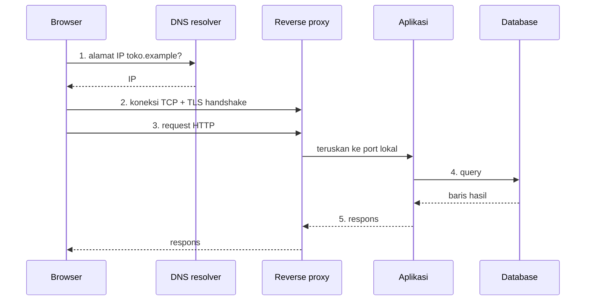

Satu request melewati beberapa tahap berurutan sebelum jawabannya sampai ke browser, dan waktu sampai byte pertama adalah jumlah waktu tahap-tahap itu.[^web-dev-ttfb] Tanpa peta tahapnya, "kenapa lambat?" hanya bisa dijawab dengan tebakan.

## Urutan tahapnya

Misalkan pengguna membuka `https://toko.example/produk/7`, dan proxy, aplikasi, serta database semuanya berjalan di satu mesin.

1. *DNS lookup*. Browser hanya tahu nama, jadi *resolver* menelusuri root server, server TLD, lalu server nama milik domain itu untuk menemukan alamat IP. Hasilnya di-*cache* (disimpan sementara) selama *TTL* record, yaitu berapa lama jawaban boleh dipakai ulang, jadi pencarian berikutnya jauh lebih murah.[^aws-route53-how-dns-routes-traffic]
2. Koneksi TCP butuh beberapa *round trip* (satu kali pergi-pulang antara dua pihak).[^mdn-http-overview] Lalu *TLS handshake*: kedua pihak menyepakati versi dan *cipher* (algoritma enkripsinya), server membuktikan identitasnya dengan sertifikat, dan mereka menyepakati kunci. Sesudahnya semua header dan body HTTP terenkripsi.[^mdn-transport-layer-security]
3. *Reverse proxy* seperti NGINX menerima request, meneruskannya ke aplikasi di port lokal (misalnya `127.0.0.1:8000`), lalu mengirim responsnya ke client. Secara default ia menahan seluruh respons dulu, supaya client yang lambat tidak menyibukkan aplikasi.[^nginx-reverse-proxy-admin-guide]
4. Aplikasi menjalankan kodenya dan mengirim query. Di database, query di-parse, dipilihkan rencana termurah oleh planner (misalnya scan seluruh tabel atau index), lalu dijalankan executor.[^pg-docs-query-path]
5. Baris hasil kembali ke aplikasi, yang menyusun respons dan mengirimnya lewat jalur yang sama.

Pada request berikutnya di koneksi yang sama, tahap 1 dan 2 biasanya hilang: DNS sudah di-cache dan koneksi bisa dipakai ulang.[^aws-route53-how-dns-routes-traffic][^mdn-http-overview] Browser juga mengirim banyak request per halaman, satu per resource.[^mdn-http-overview]

## Mencari tahap yang paling lambat

Dari browser, waktu sampai byte pertama dipecah menjadi redirect, DNS, koneksi dan TLS, lalu satu fase "request" sampai byte pertama balasan tiba.[^web-dev-ttfb] Fase itu menyembunyikan proxy, aplikasi, dan database. Untuk membukanya kamu butuh log atau timer di sisi server.

Contoh nyata: dalam satu hari di 2016, Stack Overflow mencatat 447 jam waktu pemrosesan di ASP.NET, 168 jam di query SQL, dan 2,8 jam di Redis hits (Redis: penyimpan data di memori yang dipakai seperti cache).[^craver-stack-overflow-architecture-2016] Itu jumlah dari seluruh request, bukan latency satu request, dan belum tentu tiap angka terpisah dari yang lain. Di antara tiga angka itu, ASP.NET paling besar dan Redis paling kecil.

Misalkan satu request pertama: DNS 50 ms, koneksi dan TLS 200 ms, proxy 10 ms, aplikasi 80 ms, database 560 ms. Totalnya 900 ms, dan database memegang lebih dari separuhnya, jadi database kandidat pertama. Langkah berikutnya melihat ke dalamnya: apakah planner memilih scan seluruh tabel. Tahap yang paling besar baru kandidat; ukur ulang sebelum mengubah apa pun.

## Kapan tidak perlu mencari

Kalau total masih kecil, tidak ada tahap lambat yang perlu dikejar. Patokan kasar untuk waktu sampai byte pertama (TTFB): 0,8 detik atau kurang tergolong baik, dan di atas 1,8 detik tergolong buruk. Angka itu panduan untuk halaman web, bukan target yang pasti.[^web-dev-ttfb] Satu pengukuran juga bisa menipu: request pertama membayar DNS dan koneksi, sedangkan pengukuran ulang tidak, jadi bandingkan request yang sejenis.

---
Sebagian materi diadaptasi dari *Time to First Byte (TTFB)* oleh Barry Pollard dan Jeremy Wagner, web.dev, CC BY 4.0, https://web.dev/articles/ttfb. Telah diubah.
