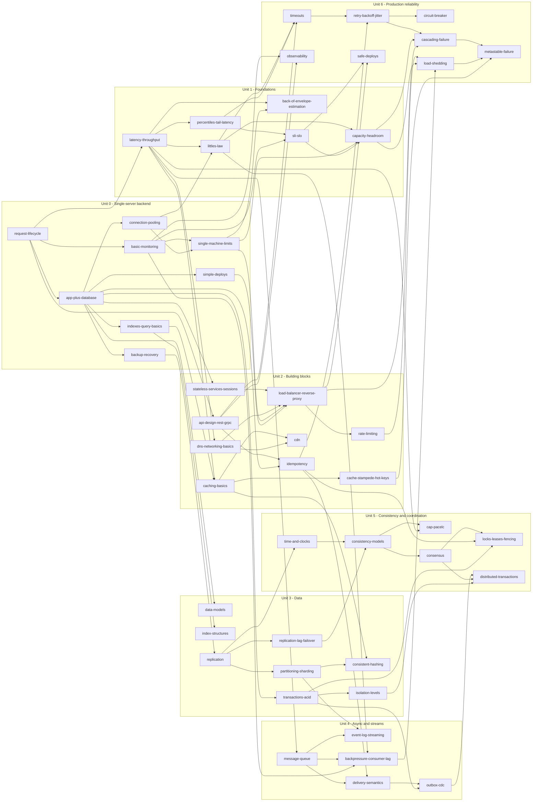

# Prerequisite graph

> Generated by `python scripts/graph.py` from `curriculum/concepts.yaml`. Do not edit by hand.

50 concepts, 84 prerequisite edges, longest chain 8 concepts. An arrow `A --> B` means: learn A before B.

Roots (no prerequisites): `request-lifecycle`. Leaves (nothing depends on them): `back-of-envelope-estimation`, `cdn`, `data-models`, `index-structures`, `consistent-hashing`, `event-log-streaming`, `cap-pacelc`, `locks-leases-fencing`, `distributed-transactions`, `circuit-breaker`, `metastable-failure`, `observability`, `safe-deploys`.

## Study order (one valid topological order, by depth)

- Level 0: `request-lifecycle` (U0)
- Level 1: `app-plus-database` (U0), `basic-monitoring` (U0), `latency-throughput` (U1), `api-design-rest-grpc` (U2)
- Level 2: `backup-recovery` (U0), `connection-pooling` (U0), `indexes-query-basics` (U0), `simple-deploys` (U0), `percentiles-tail-latency` (U1), `dns-networking-basics` (U2), `idempotency` (U2), `stateless-services-sessions` (U2), `data-models` (U3), `transactions-acid` (U3), `message-queue` (U4), `observability` (U6)
- Level 3: `single-machine-limits` (U0), `littles-law` (U1), `sli-slo` (U1), `caching-basics` (U2), `index-structures` (U3), `isolation-levels` (U3), `replication` (U3), `delivery-semantics` (U4)
- Level 4: `back-of-envelope-estimation` (U1), `capacity-headroom` (U1), `cache-stampede-hot-keys` (U2), `cdn` (U2), `load-balancer-reverse-proxy` (U2), `partitioning-sharding` (U3), `replication-lag-failover` (U3), `backpressure-consumer-lag` (U4), `outbox-cdc` (U4), `time-and-clocks` (U5), `timeouts` (U6)
- Level 5: `rate-limiting` (U2), `consistent-hashing` (U3), `event-log-streaming` (U4), `consistency-models` (U5), `retry-backoff-jitter` (U6), `safe-deploys` (U6)
- Level 6: `cap-pacelc` (U5), `consensus` (U5), `cascading-failure` (U6), `circuit-breaker` (U6), `load-shedding` (U6)
- Level 7: `distributed-transactions` (U5), `locks-leases-fencing` (U5), `metastable-failure` (U6)
