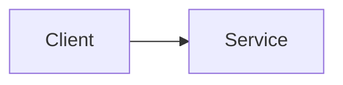

<!-- Body is written in Indonesian. Core: one scenario carried through, max 6 new italic terms, ~12-16 words per sentence. -->
Kalimat pertama adalah inti konsepnya.

Penjelasan singkat dengan satu contoh konkret.[^registry-id]

## Trade-off

Kapan ini tidak cocok dipakai, dan apa harganya.

## Diagram

## Lebih dalam

<!-- Optional, max 250 words, not counted in the core length. For readers with experience: caveats on sourced numbers, engine-specific limits, simplifications made above. The core must stand without it. Keep this section last. -->

[^registry-id]: lihat sumber
