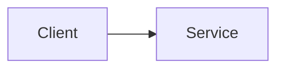

<!-- Body is written in Indonesian. -->
Kalimat pertama adalah inti konsepnya.

Penjelasan singkat dengan satu contoh konkret.[^registry-id]

## Trade-off

Kapan ini tidak cocok dipakai, dan apa harganya.

## Diagram

[^registry-id]: lihat sumber
